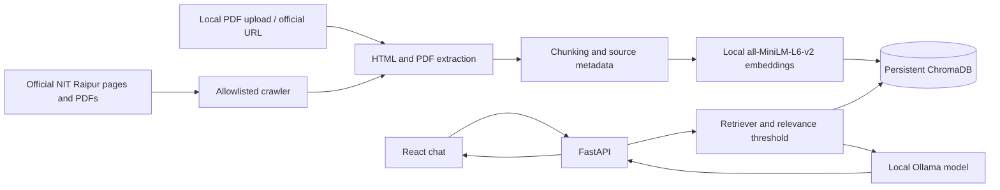

# NIT Raipur AI Assistant

A local-first RAG application for exploring public NIT Raipur information. It crawls the official `nitrr.ac.in` domain, extracts HTML and text-based PDF content with PyMuPDF (and falls back to pure-Python pypdf if the native module is blocked), indexes passages in persistent ChromaDB using local Sentence Transformers embeddings, and answers grounded questions with a locally running Ollama model. It has no paid API dependency and sends no prompt or document content to a hosted AI provider.

The crawler is intentionally bounded by configurable page, depth, size and timeout limits. A completed crawl does not imply the entire institute website was collected. Review sources and failed URLs in the Knowledge Base screen.

## Architecture



## Requirements

- Python 3.11 or later
- Node.js 20 or later and npm
- Ollama installed locally for answer generation
- Internet access for dependency/model downloads and public official-site crawling
- Model resources: `llama3.2:3b` needs several GB of storage and benefits from at least 8 GB system memory. CPU inference works but can be slow. The embedding model is downloaded on the first indexing operation.

## Windows PowerShell setup

From the repository root, open two terminals.

### Backend terminal

```powershell
py -3.11 -m venv .venv
.\.venv\Scripts\Activate.ps1
python -m pip install --upgrade pip
python -m pip install -r backend\requirements.txt
Copy-Item .env.example .env
python scripts\setup_check.py
ollama pull llama3.2:3b
python -m uvicorn app.main:app --app-dir backend --host 127.0.0.1 --port 8000
```

Install Ollama from [ollama.com/download](https://ollama.com/download) if the `ollama` command is not available. Ollama normally runs as a local service. The first indexing run downloads `sentence-transformers/all-MiniLM-L6-v2` from Hugging Face.

### Frontend terminal

```powershell
cd frontend
npm install
npm run dev
```

Open <http://127.0.0.1:5173>. The API listens on loopback port 8000 and only allows the configured development frontend origin. Do not bind it to a public network without adding authentication and deployment security controls.

## Configuration

Copy `.env.example` to `.env`. Values include:

| Variable | Default | Purpose |
|---|---|---|
| `OLLAMA_BASE_URL` | `http://localhost:11434` | Local Ollama service |
| `OLLAMA_CHAT_MODEL` | `llama3.2:3b` | Local instruct model |
| `EMBEDDING_MODEL` | `sentence-transformers/all-MiniLM-L6-v2` | Shared ingestion/query embedding model |
| `CHROMA_PERSIST_DIR` | `./data/chroma` | Persistent vector database |
| `DATA_DIR` | `./data` | Raw and extracted files and managed-source registry |
| `CRAWLER_MAX_PAGES` | `500` | Maximum visited pages per crawl |
| `CRAWLER_MAX_DEPTH` | `5` | Maximum link depth |
| `CRAWLER_SEED_URLS` | `https://www.nitrr.ac.in/` | Comma-separated official starting URLs |
| `CRAWLER_MAX_FILE_SIZE` | `20000000` | Download/upload byte limit |
| `REQUEST_TIMEOUT` | `15` | HTTP timeout in seconds |
| `RETRIEVAL_TOP_K` | `5` | Candidate passages |
| `RELEVANCE_THRESHOLD` | `0.35` | Minimum cosine-derived relevance score |
| `CHUNK_SIZE` / `CHUNK_OVERLAP` | `900` / `180` | Passage sizing in characters |
| `FRONTEND_ORIGIN` | `http://127.0.0.1:5173` | CORS allowlist origin |

Settings are read by the backend at startup. Restart it after configuration changes.

## Collect and refresh information

- Open **Knowledge base → Start official site crawl** to enqueue the official home page, follow relevant internal links and available sitemap entries, and discover linked PDFs. The interface polls the actual backend job record and reports visited/queued/indexed/failed counts as available.
- **Refresh changed pages** reruns the bounded crawl. Unchanged content hashes are skipped; changed sources replace their old source chunks.
- Use **Add an official URL** for a missed page. Only HTTP(S) URLs on `nitrr.ac.in` or its subdomains are accepted; redirects are rejected so the client can verify the destination.
- Upload a text-based PDF from the local machine. Scanned PDFs are reported as needing OCR and are not silently indexed.
- Remove a managed source in the source list to delete its chunks. Chroma files and downloaded documents are local under `data/` and excluded from Git.
- Full reindex rebuilds registered web sources from their URLs. Re-upload local PDFs if you need to rebuild an uploaded local source.

Command-line alternatives from the repository root:

```powershell
python scripts\crawl.py
python scripts\ingest.py --url https://www.nitrr.ac.in/
python scripts\ingest.py --pdf C:\path\to\public-document.pdf
```

The crawler uses a descriptive user agent, checks `robots.txt` and crawl delays when accessible, keeps requests bounded, allows only the official institute domain, and records failures in crawl job results. Site behavior and network access can limit coverage. It does not bypass access controls.

## API

The interactive API docs are available at <http://127.0.0.1:8000/docs>.

| Method | Route | Purpose |
|---|---|---|
| GET | `/api/health` | API liveness |
| GET | `/api/status` | Ollama/model/index readiness |
| GET | `/api/stats` | Indexed source and category counts |
| POST | `/api/chat` | Retrieve, relevance-check, answer and cite |
| GET | `/api/chat/suggestions` | Example questions |
| GET | `/api/sources` | Managed/indexed sources |
| POST | `/api/sources/url` | Add an allowlisted URL |
| POST | `/api/sources/upload` | Upload a local PDF |
| DELETE | `/api/sources/{source_id}` | Remove source and indexed passages |
| POST | `/api/ingestion/crawl` | Start bounded official crawl |
| POST | `/api/ingestion/incremental` | Start incremental refresh |
| POST | `/api/ingestion/reindex` | Start full reindex |
| POST | `/api/ingestion/retry` | Retry crawl-discovered failures |
| GET | `/api/ingestion/jobs/{job_id}` | Poll task progress/result |

Chat returns an explicit insufficient-evidence response when no passages meet the relevance threshold. When local retrieval succeeds but Ollama is unavailable, the API reports that separately. Citations include the stored source URL, passage and PDF page when present.

## Tests and build

```powershell
python -m pip install -r backend\requirements.txt
python -m pytest backend\tests -q
cd frontend
npm run build
```

Tests use synthetic passages and local fakes; they do not need internet access or an Ollama model. The first full backend dependency installation may download sizable PyTorch/transformer packages.

## Troubleshooting

- **Ollama unavailable:** install/start Ollama and check `http://localhost:11434/api/tags`.
- **Model missing:** `ollama pull llama3.2:3b` (or pull the name configured in `.env`).
- **Embedding model unavailable:** ensure internet access on the first ingest and enough disk/RAM; the model cache is managed by Sentence Transformers.
- **Empty index:** start a crawl, add an official URL or upload a PDF. Crawling is not automatic at startup.
- **PDF processing fails:** scanned PDFs need OCR, which is not included. Use a text-searchable PDF. PyMuPDF uses a native module; pypdf is the pure-Python fallback if Windows policy blocks that module.
- **Website request fails:** check the URL, network, robots policy, site availability and the job failure detail. External hosts, unsupported media and redirects are rejected by design.
- **CORS error:** open the Vite URL at the configured `FRONTEND_ORIGIN`, or set the environment value and restart the API.
- **Slow answers:** local CPU inference can take time. A smaller compatible Ollama instruct model can be selected using `OLLAMA_CHAT_MODEL`.
- **API missing libraries:** run `python -m pip install -r backend\requirements.txt` in the activated venv.

## Limitations

The application cannot guarantee complete or up-to-date coverage of institute content. Public pages may be unavailable, disallowed by robots policy, or inaccessible at crawl time. Publication dates and academic sessions are only used when explicitly present in extracted document metadata; fetch time is never presented as publication time. OCR, hosted deployment, authentication, streamed generation and cross-session server-side chat persistence are not included. Inspect citations and original institute documents for consequential decisions.
